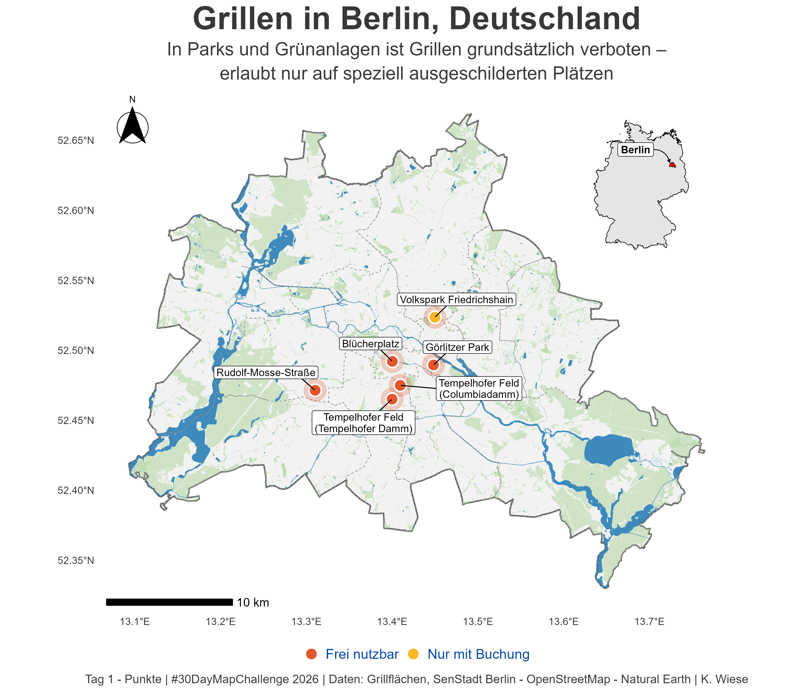

# Day 1 — Points

**Date:** 1.11.2026

## Map in Deutsch :)

## Description

**Grillen in Berlin.** My first map of the challenge is about my new environment in Berlin, and also is my effort to get to know the city and the language.

## Data

- [Grillflächen – Geoportal Berlin](https://daten.berlin.de/datensaetze/grillflachen-wms-aaeff7f1), downlod from `https://gdi.berlin.de/services/wfs/grillflaechen` (layer `grillflaechen:grillflaechen`).
- Berlin limits from OpenStreetMap (using `osmdata`)
- Germany limits: Natural Earth

## Tools

- R: `sf`, `osmdata`, `ggplot2`, `ggspatial`, `ggrepel`, `rnaturalearth`
- Script: [`Tag01_Punkte_Grillen.R`](Tag01_Punkte_Grillen.R)
