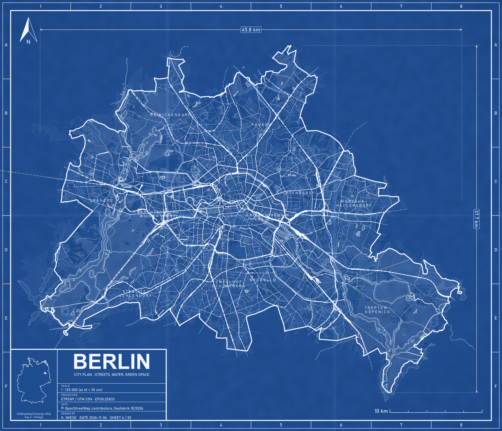
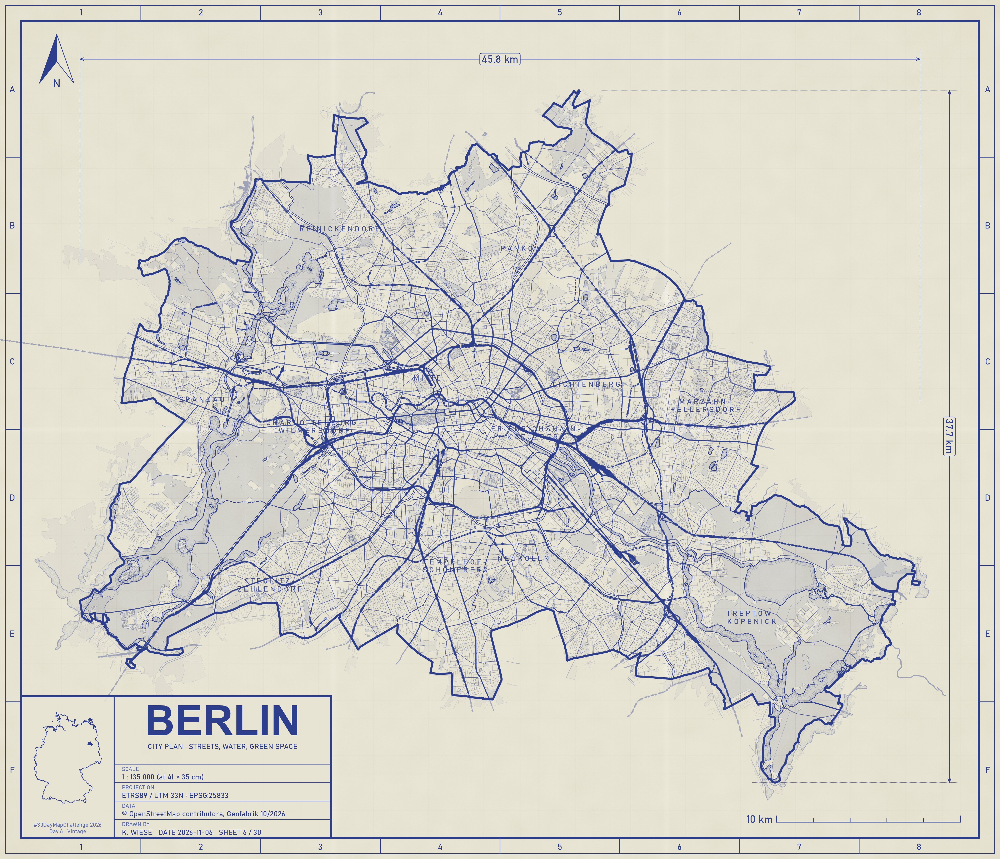

# Day 6 — Vintage

**Date:** 6.11.2026

## Map

*Diazo version (blue lines on light paper):*

## Description

**Berlin Blueprint.** A city plan of Berlin drawn as an old blueprint: streets, railways, water and green space in a single blue, with a technical title block for scale, projection and data. The idea comes from the blueprints I used to see in Tegucigalpa. The script has two styles: the classic blueprint (white lines on blue) and a diazo print (blue lines on light paper), switched with the `estilo` variable.

## Data

- Streets, railways, water and green space: OpenStreetMap via [Geofabrik](https://download.geofabrik.de/europe/germany/berlin.html) (`berlin-latest-free.shp.zip`), © OpenStreetMap contributors
- Berlin limits and Bezirke: OpenStreetMap (cached from Day 1)
- Germany limits: Natural Earth

**CRS:** ETRS89 / UTM 33N (EPSG:25833)

## Tools

- R: `sf`, `dplyr`, `ggplot2`, `ggspatial`, `scales`, `rnaturalearth`, `here`
- Script: [`Day06_Vintage.R`](Day06_Vintage.R)
