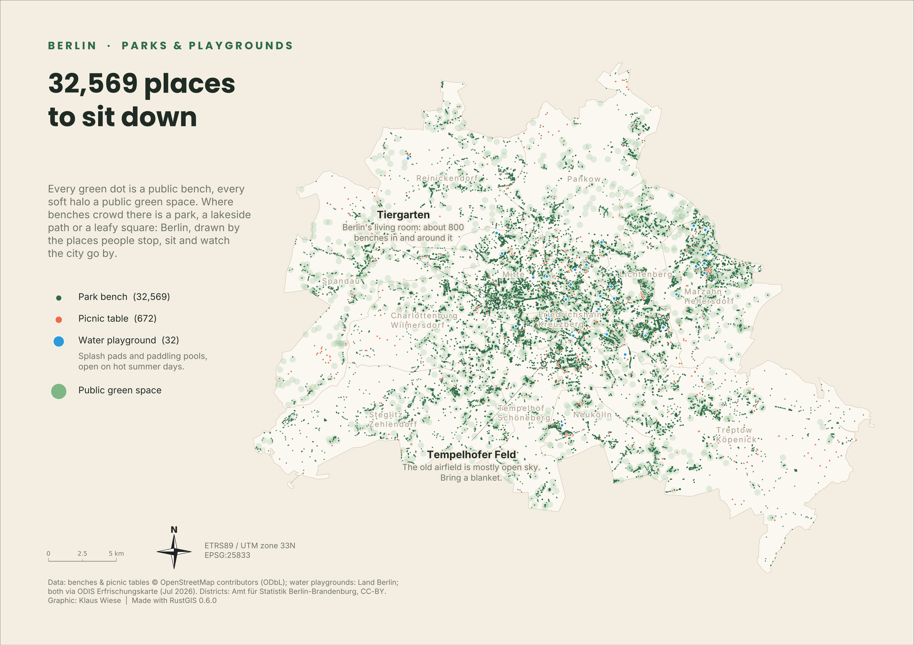

# Day 10 — Prompting only

**Date:** 10.11.2026

## Map

[PDF version](berlin_benches_rustgis.pdf)

## Description

**32,569 places to sit down.** Berlin's park benches, picnic tables and water playgrounds, made only from a short chain of plain-language prompts to Claude, with no manual GIS work:

1. "Create a map using Berlin open portal geodata and RustGIS"
2. "Look into GitHub #30DayMapChallenge repositories to get a better composition"
3. "Pick other data with more sentiment" → parks & playgrounds
4. "Make the font at least three points bigger"
5. "Add a north arrow and the EPSG"

## Data

- Benches and picnic tables: OpenStreetMap (ODbL), via the [ODIS Erfrischungskarte](https://github.com/technologiestiftung/erfrischungskarte) POIs (2026)
- Water playgrounds: Land Berlin open data, via the ODIS Erfrischungskarte
- Berlin Bezirke: Amt für Statistik Berlin-Brandenburg (CC BY)

**CRS:** ETRS89 / UTM 33N (EPSG:25833)

## Tools

- Claude (prompts only), Python, RustGIS
- Script: [`make_bench_map.py`](make_bench_map.py) · RustGIS project: [`berlin_benches.rgis`](berlin_benches.rgis)
