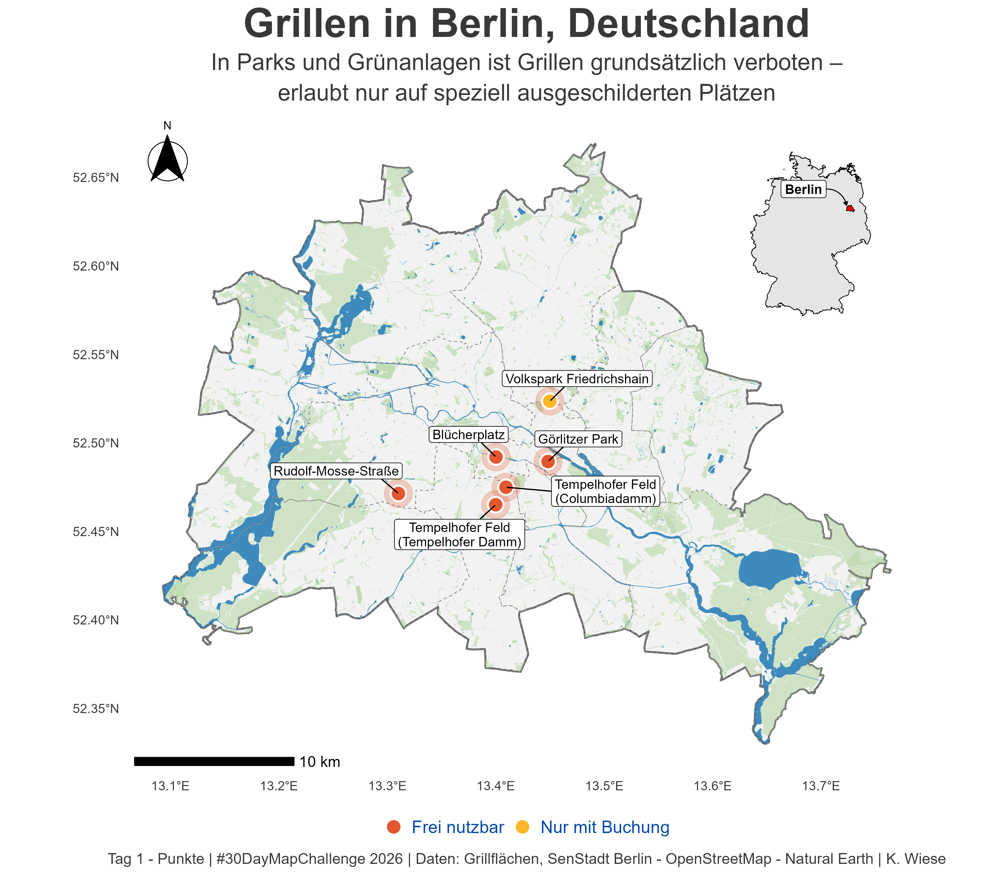
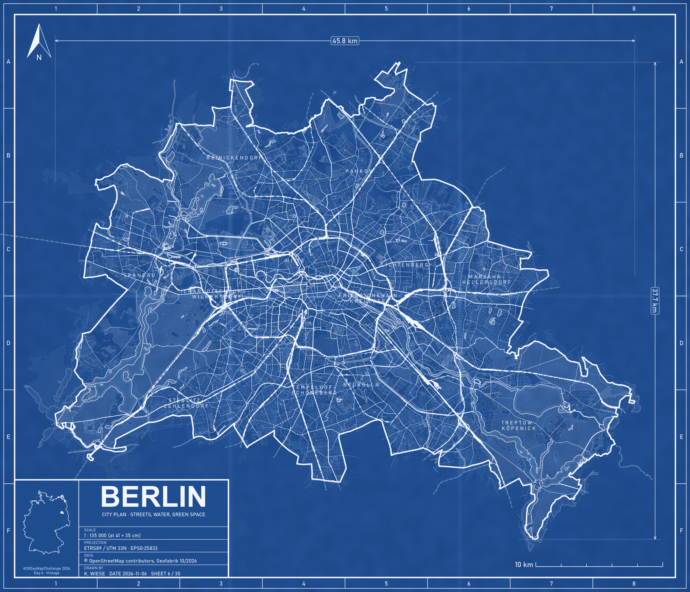
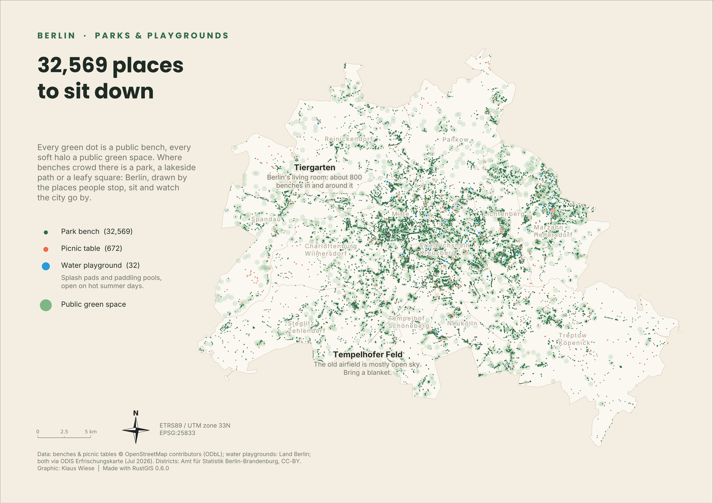

# #30DayMapChallenge 2026

My maps for the [#30DayMapChallenge](https://30daymapchallenge.com/2026/) 2026: 
one map per day, 1–30 November, each on a different theme.

Most maps focus on **Berlin and Germany**. The maps are made mainly with **R**, with occasional days in Python, RustGIS or Google Earth Engine.

New maps are added daily, so the gallery below grows throughout November.

## Gallery

| Day | Theme | Map | Code |
|----:|-------|-----|------|
| 01 | Points | <br>*Grillen in Berlin* | [R](01_Points/Tag01_Punkte_Grillen.R) |
| 02 | Lines | *Coming soon* | |
| 03 | Polygons | *Coming soon* | |
| 04 | Clusters | *Coming soon* | |
| 05 | Senses: Sight | *Coming soon* | |
| 06 | Vintage | <br>*Berlin Blueprint* · [diazo version](06_Vintage/Day06_Vintage_blueprint_EN_diazo.png) | [R](06_Vintage/Day06_Vintage.R) |
| 07 | 10 minute map | *Coming soon* | |
| 08 | Utopia | *Coming 8 Nov* | |
| 09 | Urban-rural | *Coming 9 Nov* | |
| 10 | Prompting only | <br>*32,569 places to sit down* | [Python](10_PromptingOnly/make_bench_map.py) |
| 11 | Senses: Sound | *Coming 11 Nov* | |
| 12 | Power | *Coming 12 Nov* | |
| 13 | Interactions | *Coming 13 Nov* | |
| 14 | Borgesian map | *Coming 14 Nov* | |
| 15 | Inside out | *Coming 15 Nov* | |
| 16 | Collaborative map | *Coming 16 Nov* | |
| 17 | Light & dark | *Coming 17 Nov* | |
| 18 | NULL | *Coming 18 Nov* | |
| 19 | Senses: Smell | *Coming 19 Nov* | |
| 20 | Hexagons | *Coming 20 Nov* | |
| 21 | OpenStreetMap | *Coming 21 Nov* | |
| 22 | Projections | *Coming 22 Nov* | |
| 23 | Senses: Taste | *Coming 23 Nov* | |
| 24 | Network | *Coming 24 Nov* | |
| 25 | Is this a map? | *Coming 25 Nov* | |
| 26 | Water | *Coming 26 Nov* | |
| 27 | New tool | *Coming 27 Nov* | |
| 28 | Senses: Feeling | *Coming 28 Nov* | |
| 29 | Raster | *Coming 29 Nov* | |
| 30 | Pen & paper | *Coming 30 Nov* | |

## Repository structure

```
30DayMapChallenge2026/
├── 30DayMapChallenge2026.Rproj   # project root (used by {here})
├── README.md
├── 01_Points/
│   ├── Tag01_Punkte_Grillen.R    # script
│   ├── Tag01_Punkte_Grillen.png  # final map
│   └── README.md                 # notes, data and tools for the day
├── 06_Vintage/
└── ...
```

Each day has its own folder named `NN_Theme`, containing the script, the exported map and a short README with the data sources and tools.


## Cartographic conventions

Every map includes a north arrow, a scale bar, its coordinate reference system (EPSG code) 
and credits its data sources.

## Author

**Klaus Wiese**
GitHub: [@klauswiese](https://github.com/klauswiese)

## Acknowledgements

Thanks to [Topi Tjukanov](https://github.com/tjukanovt/30DayMapChallenge) for creating 
and running the #30DayMapChallenge, the incredible mapping community and to all the open data 
providers credited on each map.

## License

Code: MIT. Maps (PNG images): [CC BY 4.0](https://creativecommons.org/licenses/by/4.0/).
